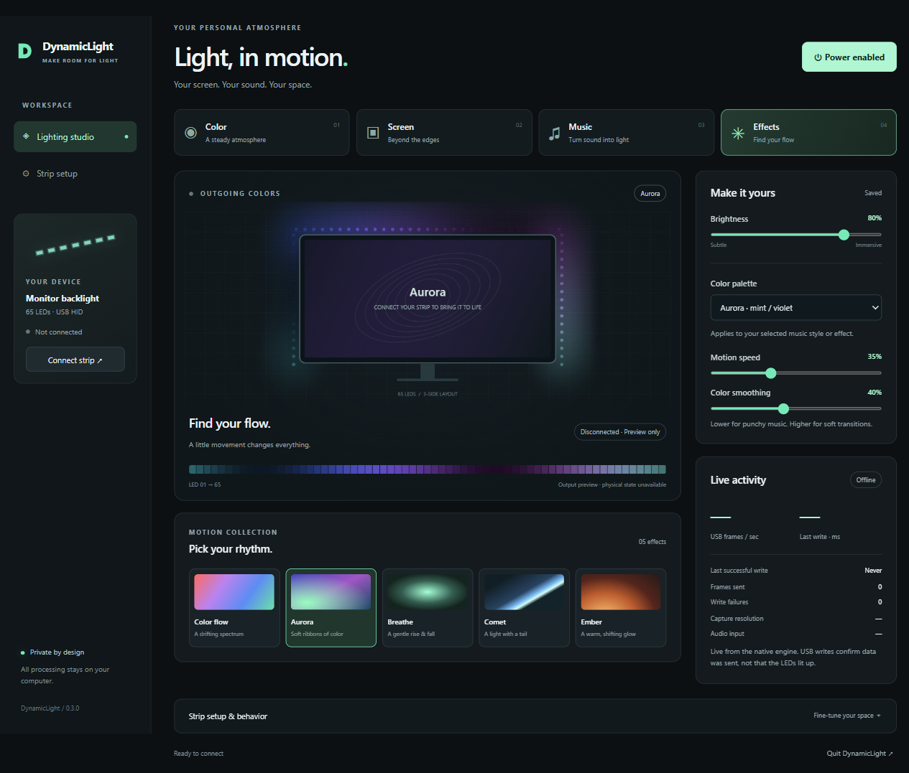

# DynamicLight

Control compatible USB LED strips with color, screen sync, music, and effects.

**Windows · macOS · Linux** · Free and open source · No account required

## Install

Download an installer from [GitHub Releases](https://github.com/mskutin/DynamicLight/releases/latest).

| Your computer | Download |
| --- | --- |
| Windows x64 | `dynamiclight-desktop-windows-x64-setup.exe` |
| Mac with Apple silicon | `dynamiclight-desktop-macos-arm64.dmg` |
| Mac with Intel | `dynamiclight-desktop-macos-x64.dmg` |
| Linux x64 | `.deb` or `.AppImage` — see [Linux setup](docs/linux.md) |

These are unsigned preview builds. macOS needs version 13 or newer. Linux targets Ubuntu 24.04+; screen sync needs X11. Windows has been tested with a physical strip; Mac and Linux hardware testing is pending.

Prefer the terminal? See [installation options](docs/installation.md). Development builds are also available from [Actions](https://github.com/mskutin/DynamicLight/actions/workflows/build.yml).

Starting with 0.9.0, **Settings → App updates** checks for new releases automatically and offers **Install and restart** on Windows, macOS, and Linux AppImage. Updates are cryptographically verified before installation. Debian packages use the terminal installer/package manager. Install 0.9.0 manually once if you have an older version. Automatic checks can be disabled.

Starting with 0.10.0, enable **Settings → Local automation** to control the running app from scripts. Install the CLI using `bash install.sh --cli` or `install.ps1 -Cli`, then run `dynamiclight status`, `dynamiclight brightness 35`, or `dynamiclight scenes apply warm-desk`. See the [CLI and local API guide](docs/automation.md) for capture consent, Stream Deck, and integration examples.

## Start lighting

1. Plug in your strip and close SyncLight.
2. Choose **Color**, **Screen**, **Music**, **Blend**, or **Effects**. The app connects and starts the mode in one action.
3. Adjust brightness in the header. Use **Stop** to turn the lights off.
4. Open **Device setup → Calibrate strip** to check the LED count, direction, and placement.

| Mode | What it does |
| --- | --- |
| Color | One color, at your chosen brightness |
| Screen | Colors from the edges of your display |
| Music | Lighting that responds to computer audio or your microphone |
| Blend | Screen colors with audio-reactive brightness |
| Effects | Color flow, Aurora, Breathe, Comet, and Ember |

The inspector beside the preview shows controls for the current mode. Each mode remembers its own tuning. Changes apply as you adjust them.

**Scenes** holds saved setups and starter scenes. Mark scenes as favorites for access from Control, Quick controls, and the tray. Import and export scenes and palettes to share them.

**Quick controls** is a small window for modes, Start/Stop, brightness, and favorites. Open it from the header or tray, and optionally keep it on top.

**Settings** holds startup, sleep behavior, capture recovery, and brightness limits. Closing a window leaves lighting running; choose **Quit DynamicLight** in Settings or the tray to exit.

The preview shows outgoing LED colors. **Connection details** shows USB delivery and opens a private troubleshooting report. The controller cannot report whether the physical LEDs are lit.

See the [controls guide](docs/controls.md) for music tuning, color tools, shortcuts, and capture behavior.

## Compatible strips

DynamicLight supports the SyncLight-compatible **ROBOBLOQ USB controller (1A86:FE07)** with 1–127 LEDs. A USB plug alone does not mean a strip is compatible.

Lights still dark? Check brightness and the message shown when starting. See [troubleshooting](docs/troubleshooting.md) or [report a problem](https://github.com/mskutin/DynamicLight/issues/new/choose).

[Planned features](BACKLOG.md) · [Developer guide](docs/development.md) · [Contributing](CONTRIBUTING.md)

Released under the [MIT License](LICENSE). Copyright © 2026 mskutin.

Studio tools: [effects, zones, bias lighting, image palettes and appearance](docs/studio-authoring.md).
