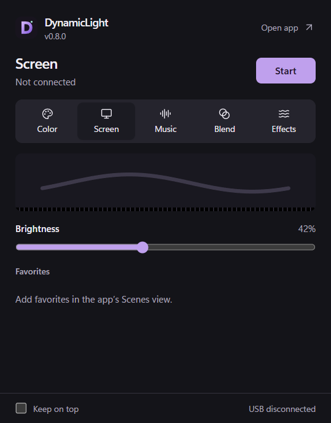

# Controls

## Control

Choose a mode to connect and start lighting. Brightness and Start/Stop stay in the header while you browse the app. Selecting another view does not change lighting or start capture.

The workspace previews outgoing colors; the inspector holds settings for the active mode. In narrow windows the controls take priority. Choose **Show output preview** to expand the larger canvas.

Each mode remembers its own tuning. Strip layout, brightness limits, and startup preferences stay shared. Changes apply while you drag; settings save when you pause.

Use **Color & palettes** for a color wheel, RGB/hex input, approximate white temperature, and named palettes of up to eight colors. Changes stay in a draft until you apply them. Custom palettes work with music, Aurora, Breathe, and Comet.

Tune music with a response style, sensitivity, and **Audio tuning** for input gain, noise gate, and release. Blend combines screen colors with audio-reactive brightness; silence keeps normal screen brightness. If one source fails, the remaining source continues and the app offers Retry.

Effect thumbnails use the same native patterns as the strip. Hover or focus one to animate its example. Previews pause when hidden and respect reduced motion. Scene examples never start screen or audio capture.

## Scenes

Use **Save scene** to save the current settings. Favorites appear in Control, Quick controls, and the tray. **Edit** lets you rename a scene, assign a global shortcut, replace its settings, duplicate, reorder, or delete it.

Selecting a scene starts lighting. Screen/audio scenes may request operating-system permission. Scene activation preserves strip layout, brightness limits, and startup preferences.

Search by name or mode, filter favorites, or save a copy of a starter scene. **Export** shares selected scenes and palettes. **Import** previews conflicts and offers keep both, replace, or skip. Importing backs up the previous library and leaves lighting alone. Display bindings, shortcuts, and startup preferences stay on this computer.

## Device setup

Set LED count, coverage, direction, and starting offset. **Calibrate strip** pauses the current scene while you step through LEDs and check the mapped edges. Apply or cancel to restore lighting. An unattended test ends after five minutes; Stop always cancels restoration.

Screen and Blend offer black-bar detection and color adjustments in the inspector. HDR and protected video can differ from the picture you see.

## Settings

Launch at login and restore-on-open start disabled. Restoration only applies if lighting was previously running; Stop keeps it off next time.

Color and effects can resume after wake or USB reconnect. Screen and audio capture require **Retry** unless you enable automatic capture recovery. Stop cancels recovery.

Display sleep, computer lock, and system sleep have separate controls. Linux display-only sleep detection needs X11; lock/suspend handling needs logind and desktop support. Mac lock detection and lifecycle behavior still need physical validation on each platform.

**Brightness limits** can cap output, soften sudden changes, or maintain a small glow while running. Stop turns output off immediately.

## Quick controls and shortcuts

Open Quick controls from the header or tray. Modes, Start/Stop, brightness, and favorites use the same engine as the main window. Changes appear in both windows. Closing Quick controls leaves lighting running. Escape hides it.

Use Ctrl+1 through Ctrl+4 (Command on Mac) for Control, Scenes, Device setup, and Settings. A scene can also have a global shortcut such as `Control+Shift+1` or `Command+Shift+1`. Linux global shortcuts need X11/XWayland support; use the app or tray if registration is unavailable.

The app version appears at the bottom of the main navigation and beneath the name in Quick controls.

## Connection details

The footer reports USB output. **Connection details** shows write timing, frame rate, errors, audio input, and missed engine deadlines. These counters do not measure physical light or video-source drops.

Open **Troubleshooting report** to preview, copy, or save a report to Downloads. Optional local history stores up to 200 state changes for seven days. Disabling it or clearing history erases it. Reports exclude paths, identifiers, scene names, screen content, and audio.
